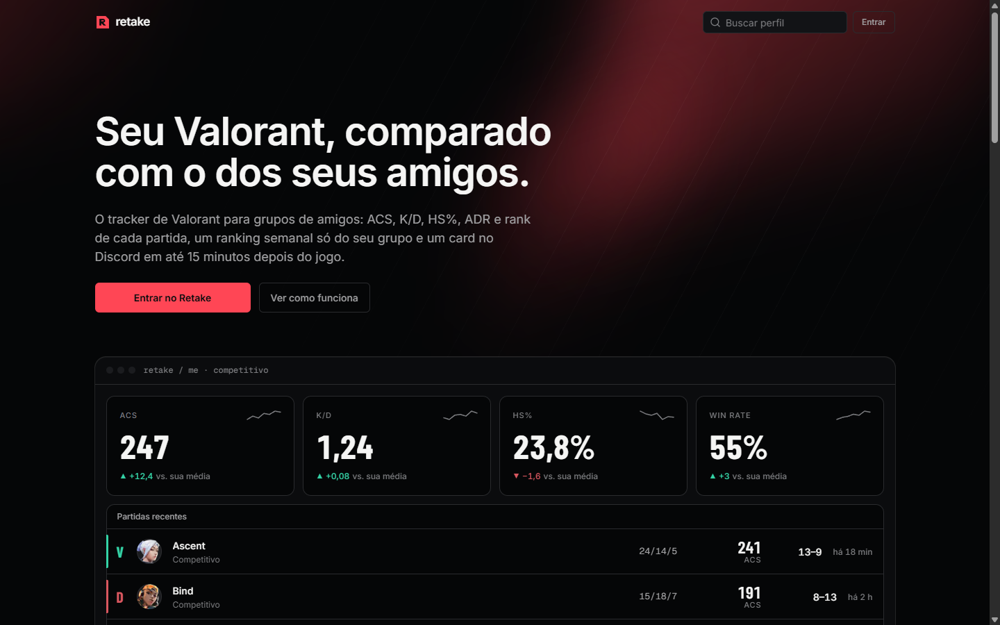
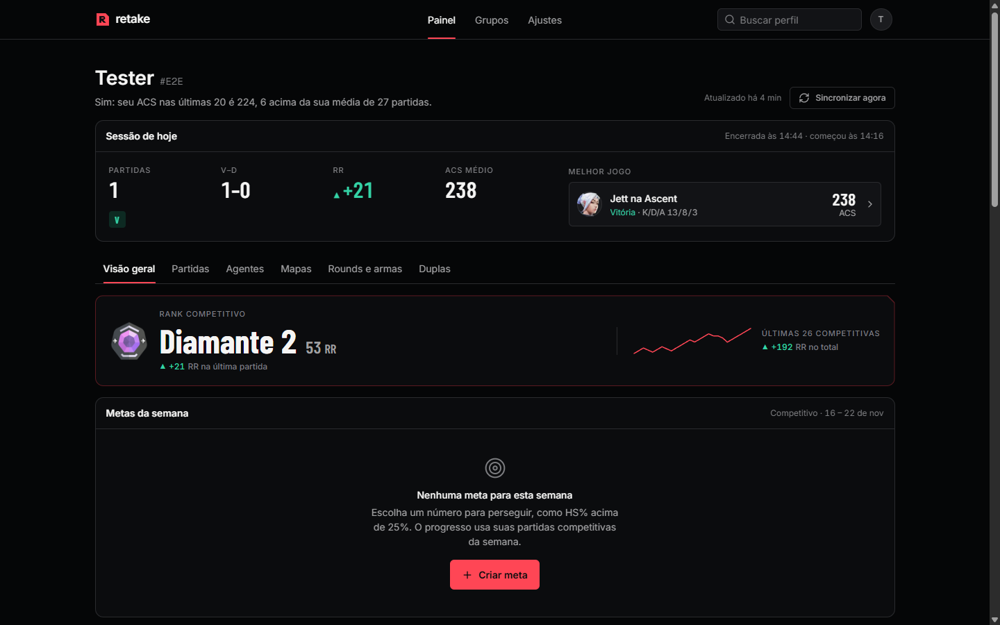
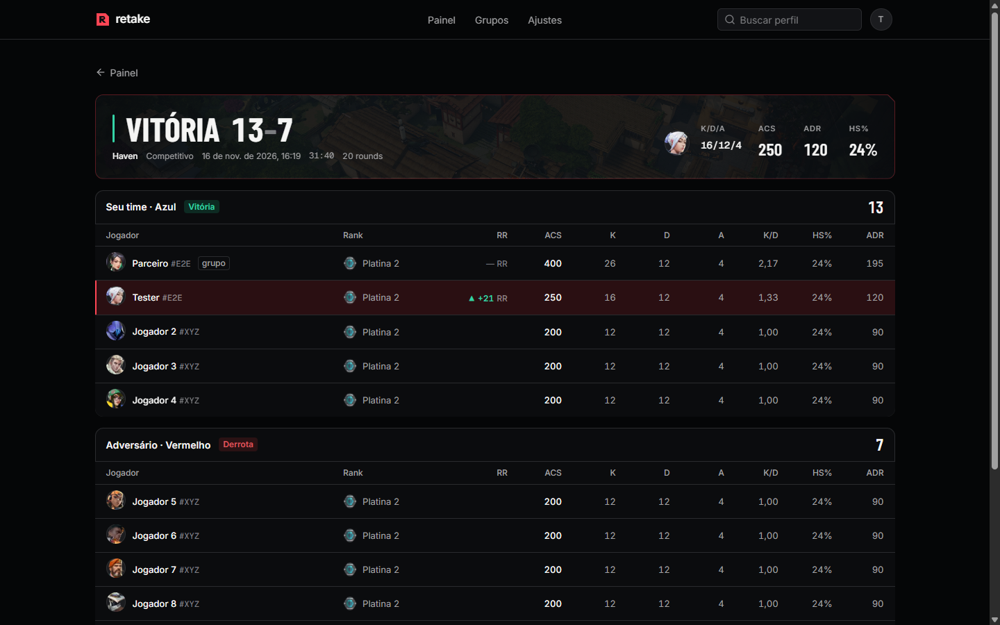
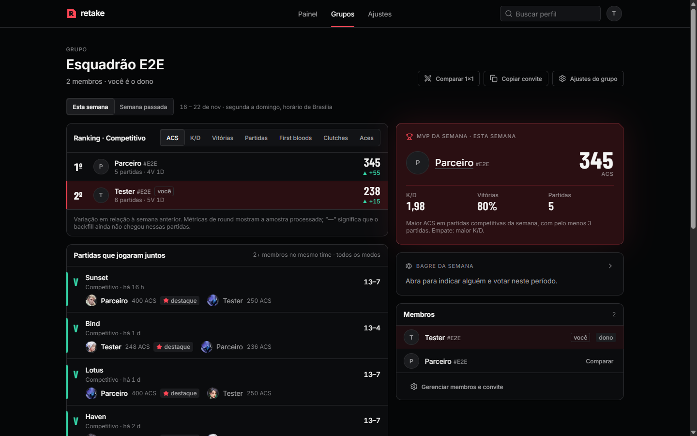
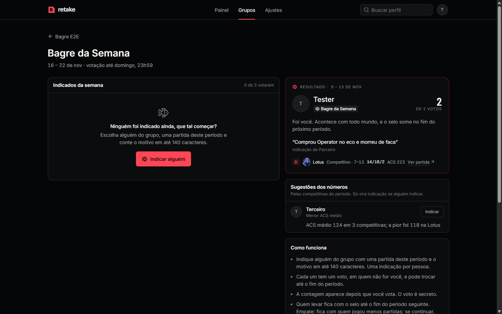
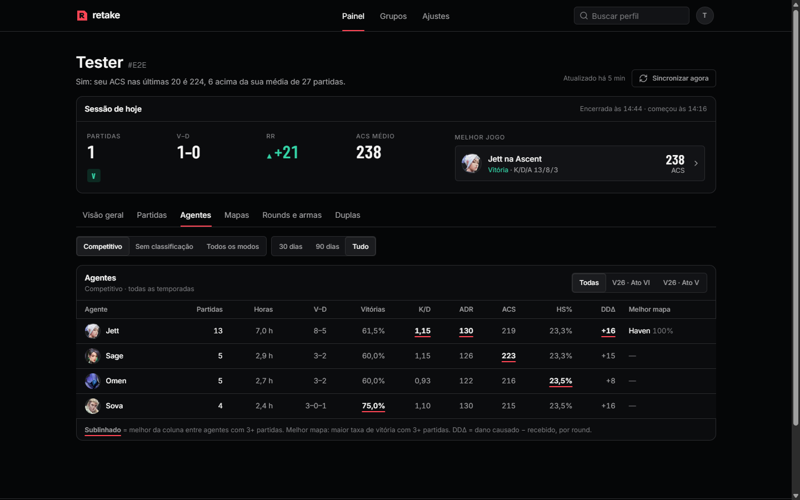
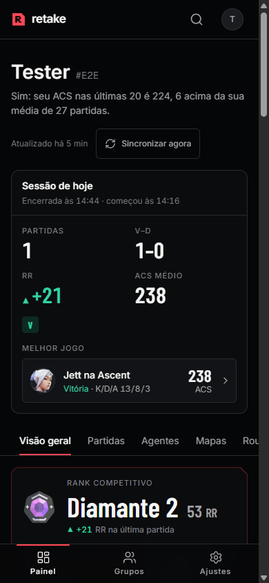
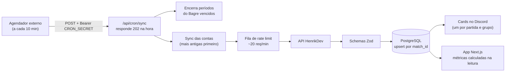

<div align="center">

# retake

**Seu Valorant, comparado com o dos seus amigos.**

Tracker de desempenho de Valorant feito para grupos de amigos: evolução pessoal, página de cada partida, ranking semanal do grupo e um card no Discord depois de cada jogo.

[**retake-gg.vercel.app**](https://retake-gg.vercel.app)




</div>

---

## Por que existe

Trackers como o Tracker.gg respondem bem à pergunta "como eu estou jogando?". O Retake parte de outra: **"como a gente está jogando?"**. O foco é o lado social: grupos privados, ranking interno da semana, as partidas que vocês jogaram juntos, com quem você rende mais e uma votação bem-humorada da pior atuação do período.

Cada tela responde uma pergunta principal:

| Tela | Pergunta |
|---|---|
| Painel | Estou melhorando? |
| Partida | Como foi essa partida? |
| Grupo | Quem mandou bem essa semana? |
| Duplas | Com quem eu vou melhor? |
| Bagre | Quem foi o Bagre? |

## Funcionalidades

### Pessoal
- **Login com Google ou Discord**, com as duas contas vinculáveis ao mesmo usuário (e sem nunca deixar o usuário sem nenhum login).
- **Vinculação do Riot ID** com validação em tempo real, prévia do card do jogador e importação do histórico recente com progresso visível.
- **Painel em abas**: visão geral, partidas, agentes, mapas, rounds e armas, duplas.
- **Sessão de hoje**: partidas seguidas com até 2 h de intervalo, V–D na ordem jogada, RR da sessão e o melhor jogo. Depois de 3 derrotas seguidas, um aviso leve sugere uma pausa (dá para desligar).
- **Rank e RR** por partida, com a curva das últimas competitivas.
- **Métricas** de ACS, K/D, KDA, HS%, ADR, DDΔ e win rate, cada uma comparando as últimas 20 partidas com a sua média.
- **Agentes**: horas, V–D, win rate, K/D, ADR, ACS, HS%, DDΔ e melhor mapa por agente, com página própria para cada um.
- **Rounds e armas**: first blood/first death, KAST, multi-kills (3K, 4K, ace), clutches 1vX, win rate por faixa de economia, ataque × defesa por mapa e abates por arma.
- **Metas da semana** (ex.: HS% acima de 25%), com progresso calculado das partidas.
- **Insights automáticos** em linguagem direta ("Sim: seu ACS nas últimas 20 é 224, 6 acima da sua média").

### Social
- **Grupos por convite** com ranking semanal por ACS, K/D, vitórias, partidas, first bloods, clutches ou aces, e o **MVP da semana**.
- **Partidas que jogaram juntos**, com quem foi o destaque de cada uma.
- **Comparação 1×1** entre membros e **perfil de membro**, visível só para quem está no mesmo grupo.
- **Sinergia de duo**: seu win rate, K/D e ACS quando joga no mesmo time de cada amigo, comparados com a sua média.
- **Bagre do grupo**: indicações com a partida e um comentário de até 140 caracteres, voto secreto que pode ser trocado, encerramento automático e selo até o fim do período seguinte. Zoeira entre amigos, nunca ranking de "piores".
- **Discord**: um card por partida no canal do grupo (listando todos os membros que jogaram), o resumo semanal toda segunda e o resultado do Bagre.
- **Resumo semanal com IA**: os números são calculados pelo código e a IA só escreve o texto. Cadeia Gemini → Groq → texto por regras, então o resumo sai mesmo sem chave nenhuma.

### Público (opt-in)
- **Perfil público** em `/u/Nome#TAG` e **busca** com sugestões a partir da 3ª letra, só para quem escolheu ser público e só com os campos escolhidos. O padrão é privado.

## Telas

<table>
  <tr>
    <td width="50%"><br><sub><b>Painel</b>: sessão de hoje, rank e RR</sub></td>
    <td width="50%"><br><sub><b>Partida</b>: placar completo, rank e RR por jogador</sub></td>
  </tr>
  <tr>
    <td><br><sub><b>Grupo</b>: ranking semanal, MVP e partidas juntos</sub></td>
    <td><br><sub><b>Bagre</b>: indicações, votação e resultado</sub></td>
  </tr>
  <tr>
    <td><br><sub><b>Agentes</b>: o melhor de cada coluna sublinhado, não só colorido</sub></td>
    <td align="center"><br><sub><b>Mobile</b>: tudo funciona em 390px</sub></td>
  </tr>
</table>

<sub>As capturas usam os dados sintéticos do seed de testes, sem nenhum jogador real.</sub>

## Como funciona



1. Um agendador externo (cron-job.org) chama `POST /api/cron/sync` a cada 10 minutos. O cron da Vercel no plano Hobby roda só uma vez por dia, por isso a rota é protegida por segredo e acionada de fora. Ela responde `202` na hora e continua o trabalho em segundo plano.
2. A rota encerra os períodos do Bagre vencidos e pega as contas com o sync mais antigo.
3. Para cada conta, busca o histórico recente na API do HenrikDev, descarta as partidas que já existem e grava as novas numa transação: partida, 10 jogadores, rounds e abates.
4. Se entrou competitiva nova, liga o RR de cada partida pelo histórico de rank.
5. Para cada grupo com webhook em que algum membro jogou, envia **um** card por partida.

## Decisões técnicas

- **O jogador é o `puuid`.** Nome e tag mudam; o `puuid` não. Todas as chaves e relações usam ele.
- **Nada de confiança na API externa.** Toda resposta passa por um schema Zod antes de tocar no banco. Campos desconhecidos são ignorados, e campos ausentes (arma nula, economia em modos sem compra) viram nulo e a métrica que depende deles ignora aquele round, avisando a amostra na UI.
- **Rate limit respeitado de verdade.** O cliente HenrikDev passa por uma fila com teto de ~20 req/min (o limite da chave é 30), lê os headers `X-RateLimit-*` e, em `429`, espera o `Retry-After`. Não há laço de retry sem espera.
- **Idempotência em tudo.** Partidas são salvas uma única vez (upsert por `match_id`), o resumo semanal sai uma vez por grupo e semana e o Bagre encerra uma vez por período, mesmo com duas rodadas do cron ao mesmo tempo.
- **Métricas calculadas, nunca armazenadas.** ACS, K/D, KAST, clutches e o resto saem de funções puras em `src/lib/stats` e `src/lib/rounds`, cobertas por testes. Mudar uma fórmula não exige migração de dados.
- **Modo sempre explícito.** Toda estatística é filtrável por modo, o padrão é competitivo, e uma média que mistura modos diz isso na tela.
- **IA com rédea curta.** No resumo semanal, a IA recebe os números prontos, tem timeout de 8 s, um `429` pula para o próximo provedor e um texto com número que não está nos dados é descartado.
- **Segredos em repouso.** Os webhooks do Discord são criptografados com AES-256-GCM. A chave da API e todo acesso externo ficam no servidor.
- **Banco de dev protegido.** Dev/e2e e produção são bancos separados, e todo script que cria dados falsos chama `assertDevDatabase()`, que só segue se o próprio banco tiver a marca `retake:dev`.

## Privacidade

- Cada usuário vincula só a própria conta, e grupos são por convite.
- Jogadores que não usam o Retake aparecem apenas no placar das partidas. Não existe perfil, busca ou página para eles.
- O perfil público é opt-in, campo a campo. Um perfil privado, um nome inexistente e um jogador que não é usuário recebem exatamente a mesma resposta.
- Grupos, Bagre e duplas nunca aparecem num perfil público.
- **Sem scouting:** não existe nenhuma estatística de adversários antes ou durante uma partida.
- Desvincular a conta Riot apaga os dados do usuário.

## Métricas

| Métrica | Fórmula |
|---|---|
| ACS | `score / rounds_played` |
| K/D | `kills / max(deaths, 1)` |
| KDA | `(kills + assists) / max(deaths, 1)` |
| HS% | `headshots / (headshots + bodyshots + legshots)` |
| ADR | `damage_dealt / rounds_played` |
| DDΔ | `(damage_dealt − damage_received) / rounds_played` |
| Win rate | vitórias / partidas (empates aparecem separados) |
| KAST | % de rounds com abate, assistência, sobrevivência ou troca (até 5 s) |
| Clutch 1vX | último vivo do time contra X adversários e o time vence o round |
| Economia | faixa pelo valor médio do equipamento do time no início do round |
| Sessão | partidas com até 2 h entre o fim de uma e o início da próxima |

O HS% por arma é aproximado (a API não diz a arma de cada tiro, então os tiros do round são atribuídos à arma comprada nele) e a interface diz isso. A lista completa, com regras de amostra mínima, está no [`CLAUDE.md`](CLAUDE.md) e na [`docs/SPEC.md`](docs/SPEC.md).

## Stack

| Camada | Tecnologia |
|---|---|
| Framework | Next.js 16 (App Router, Server Components, Server Actions), React 19, TypeScript strict |
| UI | Tailwind CSS 4, shadcn/ui, Radix, Recharts, NumberFlow, Sonner |
| Dados | PostgreSQL (Neon) + Drizzle ORM, com migrations versionadas |
| Auth | Better Auth (Google e Discord) |
| Validação | Zod em toda resposta externa e em toda Server Action |
| Dados de jogo | API HenrikDev; ícones de agentes e mapas da valorant-api.com |
| IA | Gemini e Groq (planos gratuitos), com fallback para texto por regras |
| Testes | Vitest + Testing Library (unitários), Playwright (e2e em 1440 px e 390 px) |
| Infra | Vercel (região `gru1`), cron-job.org, webhooks do Discord |

## Estrutura

```
src/
  app/
    (marketing)/          landing, login, privacidade
    (app)/                onboarding, painel, partida, grupos, Bagre, ajustes
    (public)/             perfil público /u/[riotId] e busca
    api/cron/sync/        sincronização (protegida por CRON_SECRET)
    api/auth/[...all]/    Better Auth
  db/                     schema Drizzle, cliente e trava do banco de dev
  lib/
    henrik/               cliente HTTP, schemas Zod e rate limiter
    sync/                 sincronização e backfills (independente do Next)
    stats/                métricas puras: agentes, histórico, sessão, sinergia, Bagre
    rounds/               first blood, clutch, multi-kill, KAST, economia, armas
    discord/              montagem e envio dos cards
    ai/  summary/         provedores de IA e resumo semanal
    bagre/  goals/  profile/
  components/             ui/ (shadcn) e componentes do produto
drizzle/                  migrations SQL
e2e/                      specs do Playwright e seed sintético
scripts/                  sync, resumo, Bagre e backfills pelo terminal
docs/                     SPEC.md e DEPLOY.md
DESIGN.md                 sistema visual
```

## Rodando localmente

**Pré-requisitos:** Node.js 20.9+, pnpm 10, um banco PostgreSQL (o plano gratuito do [Neon](https://neon.tech) serve) e uma chave da [API HenrikDev](https://docs.henrikdev.xyz).

```bash
git clone https://github.com/baldonigabriel/retake.git
cd retake
pnpm install
cp .env.example .env.local   # preencha as variáveis abaixo
pnpm db:migrate
pnpm dev
```

Abra `http://localhost:3000`.

### Variáveis de ambiente

| Variável | Para quê |
|---|---|
| `DATABASE_URL` | Conexão direta do Postgres (migrations e scripts) |
| `DATABASE_URL_POOLED` | Conexão com pooler, usada pelo app (obrigatória em produção) |
| `BETTER_AUTH_SECRET` | Segredo da sessão, 32+ caracteres |
| `BETTER_AUTH_URL` | URL base do app (`http://localhost:3000` em dev) |
| `DISCORD_CLIENT_ID` / `DISCORD_CLIENT_SECRET` | App OAuth do Discord; redirect em `<BETTER_AUTH_URL>/api/auth/callback/discord` |
| `GOOGLE_CLIENT_ID` / `GOOGLE_CLIENT_SECRET` | App OAuth do Google; redirect em `<BETTER_AUTH_URL>/api/auth/callback/google` |
| `HENRIK_API_KEY` | Chave da API HenrikDev (só no servidor) |
| `CRON_SECRET` | Segredo do `POST /api/cron/sync`, 16+ caracteres |
| `ENCRYPTION_KEY` | 32 bytes em base64, para criptografar os webhooks |
| `GEMINI_API_KEY` / `GROQ_API_KEY` | Opcionais, para o texto do resumo semanal |

Para gerar os segredos:

```bash
node -e "console.log(require('crypto').randomBytes(32).toString('base64'))"
```

Para rodar os testes e2e, marque o banco de desenvolvimento como tal (o seed se recusa a rodar sem a marca):

```sql
COMMENT ON DATABASE <nome_do_banco> IS 'retake:dev';
```

Nunca aplique essa marca no banco de produção.

### Comandos

| Comando | O que faz |
|---|---|
| `pnpm dev` | Servidor de desenvolvimento |
| `pnpm build` | Build de produção |
| `pnpm lint` · `pnpm typecheck` | ESLint e `tsc --noEmit` |
| `pnpm test` | Testes unitários (Vitest) |
| `pnpm test:e2e` | Testes e2e (Playwright, desktop e mobile) |
| `pnpm db:generate` · `pnpm db:migrate` | Gera e aplica migrations |
| `pnpm sync:once "Nome#TAG"` | Sincroniza um Riot ID pelo terminal |
| `pnpm summary:once <grupo>` | Prévia do resumo semanal de um grupo |
| `pnpm bagre:once <grupo>` | Prévia do resultado do Bagre |
| `pnpm rr:backfill` | Liga o RR às competitivas salvas sem ele |
| `pnpm rounds:backfill` | Completa rounds e abates das partidas antigas |

## Deploy

O passo a passo completo (Neon, Vercel, OAuth do Discord e do Google, cron-job.org e problemas comuns) está em [`docs/DEPLOY.md`](docs/DEPLOY.md).

## Documentação

- [`docs/SPEC.md`](docs/SPEC.md): escopo, modelo de dados, fluxo de sincronização, telas e fases do projeto.
- [`DESIGN.md`](DESIGN.md): sistema visual (tokens, tipografia, densidade, movimento e acessibilidade).
- [`docs/DEPLOY.md`](docs/DEPLOY.md): publicação em produção.
- [`CLAUDE.md`](CLAUDE.md): regras de dados, fórmulas e convenções do código.

## Próximos passos

- Clipes nas indicações do Bagre e novas categorias, como "jogada da semana".
- Uma nota própria de desempenho por partida, com fórmula aberta e testada.
- Cards do Discord repensados: um por sessão em vez de um por partida e preferências por membro.

## Aviso legal

O Retake é um projeto de fã, sem relação com a Riot Games. Os dados vêm da API não oficial do [HenrikDev](https://docs.henrikdev.xyz) e os ícones de agentes e mapas, da [valorant-api.com](https://valorant-api.com).

> Retake isn't endorsed by Riot Games and doesn't reflect the views or opinions of Riot Games or anyone officially involved in producing or managing Riot Games properties. Riot Games, and all associated properties are trademarks or registered trademarks of Riot Games, Inc.
